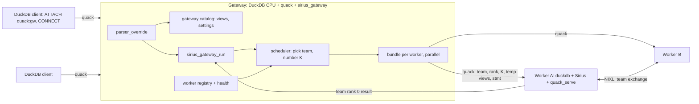
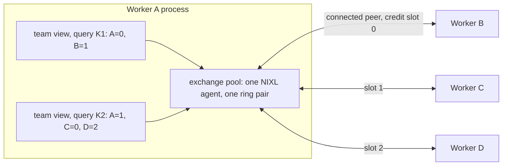

# Distributed Sirius gateway with ephemeral workers

**Status: proposed.** Nothing here is built yet. The simpler fixed-rank design is in
[distributed-gateway.md](distributed-gateway.md).

A client connects to one DuckDB endpoint over [Quack](https://duckdb.org/docs/2.0/quack/overview)
and runs plain SQL. The gateway keeps the catalog and turns each query into a **self-contained
bundle**: the workers it runs on, the query number, the views it needs, and the statement. Each
worker in that set runs the bundle on a fresh connection and keeps nothing afterwards. So workers
can join and leave between queries, and two queries can run on different workers, without
restarting the rest.



It is built in three milestones. Each one keeps the client side and the query bundle unchanged:

| Milestone | Workers | Sirius change |
|---|---|---|
| 1 | Fixed set, started by the gateway; queries already self-contained | Gateway-assigned query numbers |
| 2 | Join and leave at runtime; each query picks its team | One cached exchange per team, chosen per query |
| 3 | Same as 2, without per-team costs | One exchange per process whose peers connect and disconnect at runtime |

A **team** is the ordered list of workers one query runs on. A worker's **team rank** is its
position in that list. Team rank 0 returns the result.

## Contents

- [Quick path](#quick-path)
- [The query bundle](#the-query-bundle)
- [How a query runs](#how-a-query-runs)
- [Milestone 1: fixed workers, self-contained queries](#milestone-1-fixed-workers-self-contained-queries)
- [Milestone 2: ephemeral workers](#milestone-2-ephemeral-workers)
- [Milestone 3: a dynamic peer pool](#milestone-3-a-dynamic-peer-pool)
- [Failures](#failures)
- [Limits](#limits)
- [To verify first](#to-verify-first)
- [Files](#files)
- [Later](#later)

## Quick path

Start a gateway, then start workers. Each worker registers itself; in milestone 1 the gateway
starts them instead.

```bash
pixi run scripts/sirius_gateway.sh                     # client port 9494
pixi run scripts/sirius_worker.sh --gpu 0 --gateway quack:localhost
pixi run scripts/sirius_worker.sh --gpu 1 --gateway quack:localhost
```

From any DuckDB client:

```sql
ATTACH 'quack:localhost' AS sirius (TOKEN 'my_token');
CONNECT sirius;
CREATE VIEW lineitem AS SELECT * FROM read_parquet('/data/tpch_sf1000/lineitem/*.parquet');
SET sirius_gateway_team_size = 2;                     -- optional: default is every idle worker
SELECT l_shipmode, count(*) FROM lineitem GROUP BY 1;
DISCONNECT;
```

A third worker started now takes part in the next query; stopping one leaves the others running.

## The query bundle

What each worker receives for one query, in order, on a fresh Quack connection:

```sql
SET sirius_distributed_team = '10.0.0.1:27100,10.0.0.2:27100';  -- milestones 2 and 3
SET sirius_distributed_team_rank = 1;                           -- milestones 2 and 3
SET sirius_distributed_query_id = 4711;
SET enable_duckdb_fallback = false;
-- the client's recorded settings
CREATE TEMP VIEW lineitem AS SELECT * FROM read_parquet('/data/tpch_sf1000/lineitem/*.parquet');
SELECT l_shipmode, count(*) FROM lineitem GROUP BY 1;
```

The connection is closed afterwards, which drops the temporary views and the session settings.
Nothing a query needs comes from an earlier query.

## How a query runs

| Step | Where | What happens |
|---|---|---|
| 1 | Client | Sends SQL text over Quack. After `CONNECT`, unqualified SQL runs on the server. |
| 2 | Gateway | `parser_override` splits the text into statements and dispatches each by type (below). |
| 3 | Gateway | For a query, `sirius_gateway_run` waits for a team, then assigns K. |
| 4 | Gateway | Builds one bundle per team member and sends them **in parallel**, each on a fresh Quack connection. |
| 5 | Workers | Each plans the same SQL, scans its share by team size and team rank, and exchanges rows over NIXL as in [distributed-sirius.md](distributed-sirius.md). |
| 6 | Gateway | Buffers team rank 0's result, waits for every member, closes the connections and releases the team. |
| 7 | Client | Receives the result. |

How the parser hook dispatches statements:

| Statement | Handling |
|---|---|
| `CREATE VIEW`, `CREATE MACRO`, `SET`, other DDL | Run on the gateway's own catalog and recorded as text. Not sent to workers. |
| `SELECT`, `EXPLAIN`, `COPY ... TO` | Rewritten to `FROM sirius_gateway_run('<stmt>')`. |
| `sirius_gateway_*`, `quack_*`, Quack-internal statements, the gateway's own marked connections | Left alone. |

Members of a team run in parallel because they wait on each other inside the exchanges.

## Milestone 1: fixed workers, self-contained queries

The worker set is fixed, but queries are already self-contained, so milestone 2 needs no rework
on the gateway side.

**Sirius: gateway-assigned query numbers.** Exchange stream ids come from the query number:
`stream = (query << query_stream_bits) | n` (`src/planner/distributed_plan.cpp:112`). Today each
process counts its own distributed queries (`distributed_queries_`), and those counts can drift.
A session setting `sirius_distributed_query_id` lets the gateway assign K instead. Sirius uses it
when nonzero and requires it to increase; gaps are fine.

**Gateway.**

- `CALL sirius_gateway_start(ranks, exchange_base_port, quack_base_port)` starts one
  `duckdb -unsigned` per GPU (`CUDA_VISIBLE_DEVICES=i`). Each one has fixed `sirius_exchange_peers`
  and `sirius_exchange_rank` and runs `quack_serve`. They all start together, because
  `SET sirius_exchange_rank` connects NIXL and waits for every peer.
- Admission is a strict FIFO queue, one query at a time, and the team is always every worker.
- The one-connection-per-process rule in `next_distributed_query` (`src/sirius_context.cpp`) holds,
  because each bundle's connection closes before the next one opens.

## Milestone 2: ephemeral workers

### What blocks it today

The exchange is fixed per process the first time it is used:

- `nixl_fabric` connects to every peer in its constructor.
- The receive ring's credits are split by world size at start (`src/exchange/transport.hpp`).
- Any peer failure stops the transport for good.
- `get_exchange_service` refuses a change of peers (`src/sirius_context.cpp:1360`).
- Operators and collectives read one process-wide `service->world_size()` and `rank()`.

### Sirius: one cached exchange per team

- **Team settings per query.** Session settings `sirius_distributed_team` (the team's exchange
  listeners, `host:port` in team-rank order) and `sirius_distributed_team_rank`. The static
  `sirius_exchange_peers` and `sirius_exchange_rank` remain for scripts.
- **Team cache.** `SiriusContext` keeps a map from team to `exchange_service`, replacing the single
  `exchange_service_` (`src/sirius_context.hpp:1045`). A new team connects on its first query.
  Every operator keeps working unchanged, since world size and rank already come from the service.
- **Dropping a team.** `CALL sirius_exchange_drop_team('<team>')` destroys the service and frees
  its rings. A team whose transport failed is dropped too, and each team instance has a unique
  NIXL agent name, so the same workers can form the team again.
- **One distributed query per worker at a time.** `SORT_SAMPLE` and the Bloom merges block GPU
  worker threads, so two overlapping teams running at once could deadlock each other.

### Gateway: registry and scheduler

- **Registry.**
  - A worker registers on start-up with
    `quack_query('quack:gw', 'CALL sirius_gateway_register(quack_uri, exchange_host, port_base, gpu)')`,
    or an operator calls `sirius_gateway_add_worker(...)`.
  - `sirius_gateway_remove_worker(id, drain := true)` waits for the worker's current query.
  - A health check (`SELECT 1`) removes workers that stop answering.
- **Scheduler.**
  - The team is every idle healthy worker by default. A session can ask for
    `sirius_gateway_team_size` or name `sirius_gateway_workers`.
  - The scheduler takes all of a team's workers at once or waits, in FIFO order. Teams that don't
    share a worker run at the same time.
  - K is unique across the whole gateway.
- **Team cache owner.**
  - The gateway gives each new team a listener port slot on each member (`port_base + slot`).
  - It calls `sirius_exchange_drop_team` when evicting a team (each one holds GPU rings, so only a
    few stay cached) and on every team that contains a departing worker. Other teams are untouched.
- **Retry.** A read-only query whose team lost a worker is retried once on a new team. That is
  safe because the query carries all its inputs.

## Milestone 3: a dynamic peer pool

Milestone 2 works, but every new team pays a NIXL connect and holds its own rings, agent and
listener port on each member. So only a few teams can stay cached, and a change of worker set
costs seconds. Milestone 3 gives each process **one** exchange, a pool of peers that grows and
shrinks at runtime. Each query uses a **team view** of that pool.



The gateway and the bundle stay the same: each query still carries its team and team rank.
Only how a worker turns those into an exchange changes.

### Sirius: what changes, layer by layer

| Layer | Today (`src/exchange/`) | Milestone 3 |
|---|---|---|
| Fabric (`fabric.hpp`, `nixl_fabric.*`) | The constructor takes every peer, fetches each one's metadata and trades hellos. `rank()` and `world_size()` are fixed. | The constructor only registers the rings and starts the listener. `connect(address)` fetches one peer's metadata, trades a hello and returns a stable **peer id**. `disconnect(peer)` invalidates its metadata and unmaps its host mirror. Peer ids are never reused within a process. |
| Credits (`transport.cpp:179`) | `credits_per_peer = recv_ring.frames() / peers`, one slot per rank, fixed at start. | The receive ring is cut into `sirius_exchange_max_peers` **slots** of equal size. `connect` grants the peer a free slot and names it in the hello. `disconnect` frees the slot once all its frames have come back. With no free slot, `connect` fails and so does the query, with a clear error. |
| Failure (`transport.cpp`, `on_error`) | Fail-stop: any failed write, malformed message, peer error or stall ends the transport for every query. | **Per peer.** A failure involving peer P marks P failed and disconnects it. The queries whose team includes P are aborted, and the transport carries on for everyone else. Only a local fault, such as failing to register the rings, stays fatal. |
| Service (`exchange_service.*`) | Streams keyed by stream id; `abort` tells every peer. | Each query registers its team view. Arrivals are tagged with the sender's peer id and mapped to a team rank when the stream's source attaches, so early arrivals still work. `abort` goes only to the team's members. |
| Team view (new) | — | `exchange_team{query K, members as peer ids, self}` built from `sirius_distributed_team` and `sirius_distributed_team_rank`. Missing members are connected before planning, with a timeout. |
| Operators and collectives | Read `service->world_size()` and `service->rank()`. | Read the team view. Call sites: `sirius_physical_exchange_sink.cpp`, `sirius_physical_exchange_source.cpp`, `sirius_physical_sort_sample.cpp:436`, `dynamic_filter_publisher.cpp:1094`, `distributed_plan.cpp:135,219,283,419,432`, and `all_gather` / `leave_all_gather`. `send(stream, team_rank)` maps the team rank to a peer id. |
| `SiriusContext` | One `exchange_service_` (milestone 2: a team cache). | One pool, created on first use. `get_exchange_team(params)` replaces `get_exchange_service`. The team cache and `sirius_exchange_drop_team` go away. |

**Settings.**

| Setting | Meaning |
|---|---|
| `sirius_exchange_listen` | This worker's one exchange listener, `host:port`. |
| `sirius_exchange_max_peers` | How many peers can be connected at once; sets the credit slot count. |
| `sirius_distributed_team`, `sirius_distributed_team_rank` | Per query, as in milestone 2, but the addresses are each worker's single listener. |
| `sirius_exchange_peers`, `sirius_exchange_rank` | Kept as shorthand: a team made of every peer, for scripts. |

**Idle peers.** A peer that no team has used for a while is disconnected to free its slot. So is a
peer the gateway reports as gone, through `CALL sirius_exchange_forget_peer('<address>')`.

**Still one distributed query per worker at a time.** The pool lets many teams share a
process's connections, but `SORT_SAMPLE` and the Bloom merges still block GPU worker threads, so
overlapping teams still run one after the other.

### Gateway changes

- **Registry.** It stores one exchange address per worker. Port slots go away.
- **Teams.** No team cache, no eviction, no `sirius_exchange_drop_team`. When a worker leaves,
  the gateway calls `sirius_exchange_forget_peer` on the others (best effort; idle disconnect and
  per-peer failure cover the rest).
- **Pre-warm (optional).** When a worker joins, the gateway can ask a few workers to connect to
  it, so its first query doesn't pay the connect.
- **Scheduler.** Unchanged.

### Getting there from milestone 2

Each step keeps the tests green and can ship on its own:

1. Add `connect` and `disconnect` to the fabric. The existing constructor calls `connect` for
   every peer, so nothing else changes yet.
2. Replace the fixed credit split with slots granted on connect.
3. Replace fail-stop with per-peer failure and team-scoped abort.
4. Add the team view, and move the operators and collectives onto it.
5. Switch `SiriusContext` from the team cache to the pool, and remove `sirius_exchange_drop_team`
   and the gateway's port slots.

### Tests

- **Transport over the loopback fabric** (`[exchange][transport]`):
  - connect and disconnect a peer while traffic flows between other peers;
  - a failed peer aborts only the queries that include it;
  - a freed slot is reused;
  - a full pool refuses `connect`.
- **Operators** (`[exchange][operators]`, `[exchange][collectives]`): a team of 2 inside a pool of
  4, including `SORT_SAMPLE` and the Bloom merge.
- **NIXL, one process per GPU** (`[nixl_multiprocess]`): 4 workers alternate between teams
  {A,B}, {C,D} and {A,B,C,D}. After D is killed, {A,B} keeps running and {A,B,C} works with no
  restart.

## Failures

| What fails | Milestone 1 | Milestone 2 | Milestone 3 |
|---|---|---|---|
| The query fails on every worker | Return the root-cause error | Same | Same |
| Workers disagree | Restart every worker; nothing to replay | Drop that team; other teams are untouched | Abort the query on its team; nothing is dropped |
| A worker dies, or its link fails | Restart every worker | Remove the worker, drop its teams, retry read-only queries once on a new team | Peers mark it failed and disconnect it. Only its queries abort; read-only ones are retried once |
| The client cancels | `quack_cancel` on every team member | Same | Same |

`FROM sirius_gateway_status()` shows the workers, their state and teams, the last K, and the
queue.

## Limits

- **No overlapping teams at once:** a worker runs one distributed query at a time. Running
  overlapping teams together would need non-blocking collectives.
- **Gateway sees the files:** `CREATE VIEW` binds on the gateway, so DuckDB reads Parquet schemas
  there. The gateway must reach the same paths as the workers.
- **Global catalog:** recorded views and settings are shared by every client for now.
- **Cached team costs (milestone 2 only):** a new team pays one NIXL connect; each cached team
  holds GPU rings and a listener port per member. Milestone 3 removes these.
- **Peer cap (milestone 3):** at most `sirius_exchange_max_peers` peers are connected at once,
  since each one holds a credit slot in the receive ring.
- **Buffered results:** team rank 0's result is held in gateway memory before it is returned.
- **Per-worker evaluation:** `now()` and `random()` are evaluated separately on each worker.
- **Not covered:** multi-host ranks (untested), prepared statements, result expiry, persistence,
  multiple gateways.

## To verify first

1. A Sirius worker running `quack_serve` executes a distributed query driven by `quack_query`
   from another process.
2. After `ATTACH` and `CONNECT`, the gateway's `parser_override` sees the client's raw SQL. If
   not, the fallback is for clients to call `quack_query('quack:gateway', sql)`.
3. Which statements Quack issues on its own, so the hook leaves them alone.
4. Whether `quack_query` accepts several statements. If not, a bundle is a few calls on one
   `ATTACH`, then `DETACH`.

## Files

| File | Role |
|---|---|
| `gateway/` (new) | `sirius_gateway` extension: parser hook, catalog recording, `sirius_gateway_run`, scheduler, registry, team cache owner |
| `sirius-duckdb/extension_config.cmake` | Also loads `quack` (pinned in `duckdb/.github/config/extensions/quack.cmake`) and `sirius_gateway` |
| `src/sirius_extension.cpp`, `src/sirius_config.hpp` | Settings `sirius_distributed_query_id`, and in milestone 2 `sirius_distributed_team` and `sirius_distributed_team_rank` |
| `src/sirius_context.{hpp,cpp}` | Query number in `next_distributed_query`; in milestone 2 the team cache and `sirius_exchange_drop_team`; in milestone 3 the pool and `get_exchange_team` |
| `src/exchange/fabric.hpp`, `nixl_fabric.*` | Milestone 3: `connect` and `disconnect`, stable peer ids |
| `src/exchange/transport.*`, `messages.*` | Milestone 3: credit slots, per-peer failure, team-scoped abort |
| `src/exchange/exchange_service.*`, `all_gather.*` | Milestone 3: team views, arrivals mapped from peer id to team rank |
| `src/op/sirius_physical_exchange_{sink,source}.*`, `sirius_physical_sort_sample.cpp`, `src/op/dynamic_filter/dynamic_filter_publisher.cpp`, `src/planner/distributed_plan.*` | Milestone 3: read the team view instead of the service's world size and rank |
| `scripts/sirius_gateway.sh`, `scripts/sirius_worker.sh` (new) | Start the gateway; start and register one worker |

## Later

- **Overlapping teams at once:** let a worker run several distributed queries together. That
  needs `SORT_SAMPLE` and the Bloom merges to stop blocking GPU worker threads.
- **Per-session catalogs:** keep each client session's views and settings apart on the gateway.
- **Streaming results:** pass team rank 0's result to the client without buffering it.
- **Multi-host:** test teams across hosts and networks without RDMA.
