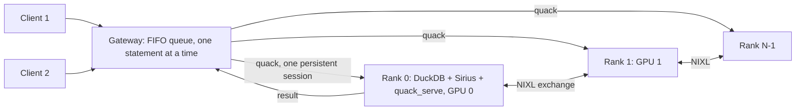
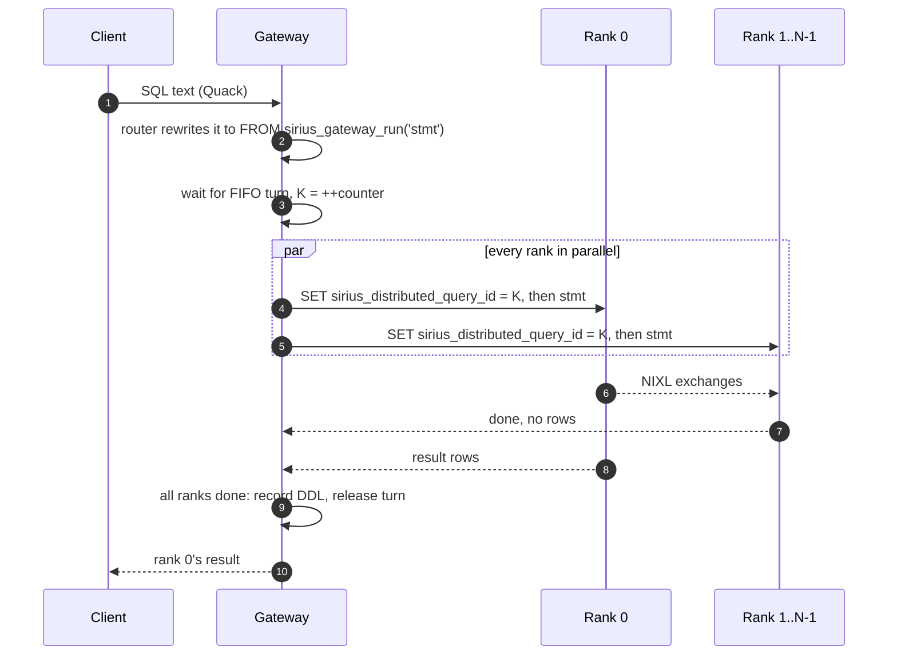
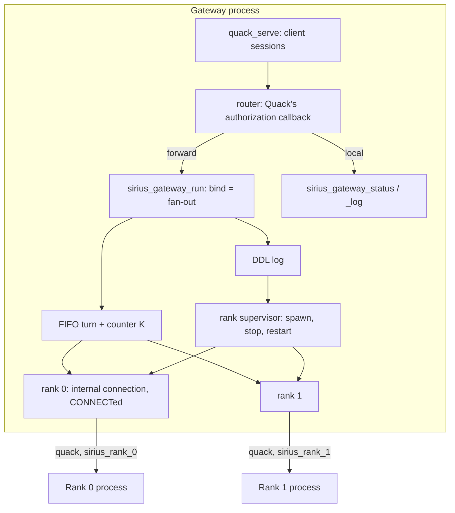
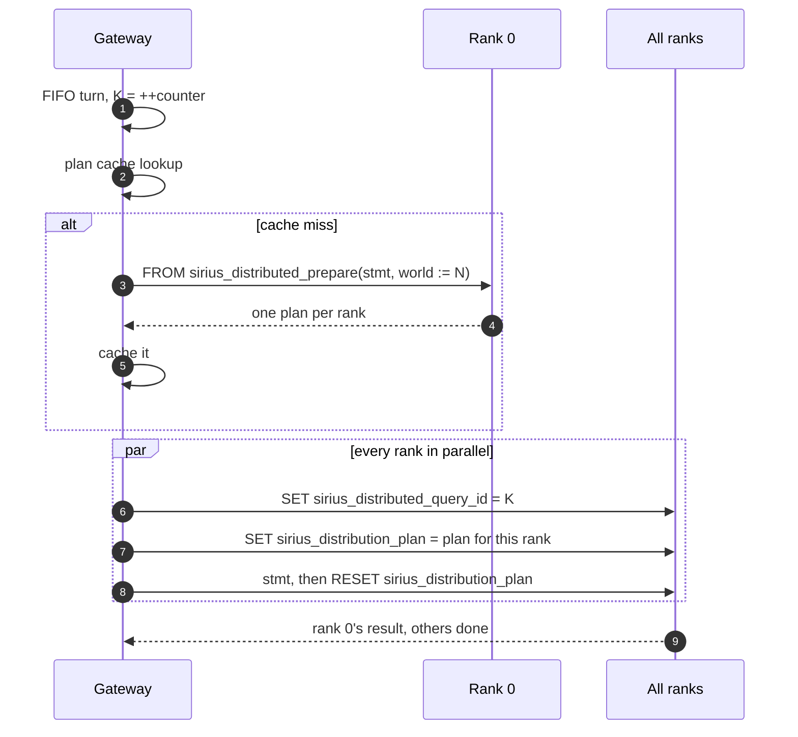
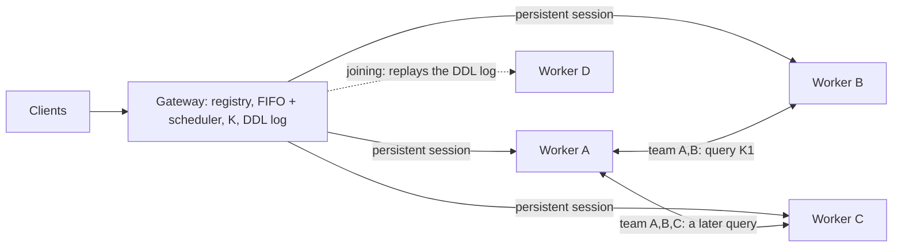

# Distributed Sirius gateway: one entry point for every rank

**Status:** the fixed-rank gateway is built (`gateway/`), up to [Planning once](#planning-once).
Planning once and [ephemeral workers](#ephemeral-workers) are proposed only.

Today a distributed query needs every rank started by hand (or by
`scripts/distributed_run_sql.sh`), and every rank must be sent the same statements in the same
order. The gateway removes both chores. A client connects to one DuckDB endpoint over
[Quack](https://duckdb.org/docs/2.0/quack/overview) and runs plain SQL. The gateway sends each
statement to every rank, one statement at a time, and returns rank 0's result.



This is the simple version: a fixed set of ranks, started once.
[Ephemeral workers](#ephemeral-workers) extends it so workers join and leave between queries.
[distributed-gateway-ephemeral.md](distributed-gateway-ephemeral.md) describes a variant without
persistent sessions.

## Contents

- [Quick path](#quick-path)
- [What the gateway is in charge of](#what-the-gateway-is-in-charge-of)
- [How a statement runs](#how-a-statement-runs)
- [Ordering and query numbers](#ordering-and-query-numbers)
- [Why one persistent session per rank](#why-one-persistent-session-per-rank)
- [Implementation](#implementation)
- [Planning once](#planning-once)
- [Ephemeral workers](#ephemeral-workers)
- [Failures](#failures)
- [What the gateway does not do](#what-the-gateway-does-not-do)
- [Limits](#limits)
- [To verify first](#to-verify-first)
- [Tests](#tests)
- [Files](#files)
- [Later](#later)

## Quick path

Build the gateway (a CPU-only DuckDB with `httpfs`, `quack` and `sirius_gateway`), then start it
and 4 ranks, one per local GPU:

```bash
pixi run make -C gateway release
SIRIUS_GATEWAY_TOKEN=my_token pixi run scripts/sirius_gateway.sh 4   # client port 9494 by default
```

From any DuckDB client (CLI, Python, another DuckDB process):

```sql
ATTACH 'quack:localhost' AS sirius (TOKEN 'my_token');
CONNECT sirius;
CREATE VIEW lineitem AS SELECT * FROM read_parquet('/data/tpch_sf1000/lineitem/*.parquet');
SELECT l_shipmode, count(*) FROM lineitem GROUP BY 1;   -- runs on every rank, rank 0's result
DISCONNECT;
```

The client never sets `sirius_exchange_peers` or `sirius_exchange_rank` and never starts a rank.

## What the gateway is in charge of

| Responsibility | What the gateway does | Provided by |
|---|---|---|
| Client endpoint | Accepts Quack sessions, checks the token, streams results back | Quack (`quack_serve`) |
| Rank lifecycle | Starts one rank process per GPU, health-checks it, restarts every rank together, stops them on shutdown | `sirius_gateway`: rank supervisor |
| Statement routing | Decides per statement: forward to every rank, or run on the gateway itself | `sirius_gateway`: router (Quack's authorization callback) |
| Ordering | One statement at a time, in arrival order across all clients; assigns the query number K | `sirius_gateway`: FIFO queue |
| Fan-out | Sends K and the statement to every rank in parallel; returns rank 0's result | `sirius_gateway`: `sirius_gateway_run` |
| Consistency | Detects ranks that disagree or a failed transport, then restarts and replays the DDL log | `sirius_gateway`: recovery |
| Cancellation | Turns a client's cancel into `quack_cancel` on every rank | `sirius_gateway` + Quack |
| Observability | Rank state, queue depth, last K, the DDL log, per-rank log files | `sirius_gateway_status()`, `sirius_gateway_log()` |

Planning, splitting the scans, moving rows between ranks and GPU memory all stay with Sirius on
the ranks. See [What the gateway does not do](#what-the-gateway-does-not-do).

## How a statement runs



All statements are forwarded, not just queries: `CREATE VIEW`, `SET` and `ATTACH` must reach
every rank too, since each rank plans for itself. The ranks must run in parallel, because they
wait on each other inside the exchanges; sending to rank 0 and then to rank 1 would hang.

## Ordering and query numbers

Exchange stream ids come from the query number:
`stream = (query << query_stream_bits) | n` (`src/planner/distributed_plan.cpp:112`). Every rank
must therefore number a query the same way.

- **Serialized.** The gateway runs one statement at a time, cluster-wide, in arrival order.
  Two clients' statements are interleaved, never overlapped, and every rank sees the same order.
- **Numbered by the gateway.** Today each rank counts its own distributed queries
  (`distributed_queries_` in `src/sirius_context.hpp`). If a statement fails before planning on
  one rank but not on another, the counts drift and every later query's streams go wrong. A new
  session setting, `sirius_distributed_query_id`, lets the gateway assign K. Sirius uses it when
  nonzero and requires it to increase. Gaps are fine, so statements that never reach the GPU,
  such as DDL, still use up a number.

This is the only Sirius change the gateway itself needs. [Planning once](#planning-once) adds
more, and is optional.

## Why one persistent session per rank

Sirius lets one connection per process run distributed queries. `next_distributed_query`
(`src/sirius_context.cpp`) refuses any other connection until that one closes. On a rank, every
Quack client session is its own connection.

So clients never connect to ranks directly. The gateway holds exactly one long-lived Quack
session per rank (`ATTACH 'quack:host:port' AS sirius_rank_<i>`), and every client's statements
go through it. A side effect: clients share one session per rank, so a view one client creates is visible to
all.

## Implementation

The gateway is a stock DuckDB v2.0 binary built by `gateway/Makefile` from the same DuckDB
checkout as `sirius-duckdb`, with `httpfs`, **Quack** and the CPU-only **`sirius_gateway`**
extension linked in (`gateway/build/release/duckdb`). It does not load Sirius and needs no GPU.
The ranks run `sirius-duckdb/build/release/duckdb`, which links Quack too.

### Components



| File | Part |
|---|---|
| `gateway/src/sirius_gateway_extension.cpp` | `Load`: settings, the router function, the table functions |
| `gateway/src/statement_router.cpp` | Routing rules |
| `gateway/src/gateway_state.cpp` | Per-database state: the FIFO turn, K, the fan-out, outcomes, the DDL log, recovery, bring-up |
| `gateway/src/rank_supervisor.cpp` | Spawning and ending rank processes |

One `gateway_state` per database instance holds the ranks, the FIFO, K and the DDL log. Every
statement, and every start, stop and restart, takes the one turn, in arrival order.

### DuckDB and Quack hooks it uses

| Hook | Used for |
|---|---|
| Quack's `quack_authorization_function` setting | Quack calls the named function with each client statement before running it, and runs the text the function returns. The gateway sets it to `sirius_gateway_route`, so only Quack client traffic is routed: the gateway's own console and internal connections are not. |
| `CONNECT` on an internal connection | One connection per rank, CONNECTed to the rank's attached catalog `sirius_rank_<i>`. DuckDB then sends each statement's text verbatim, and the rank runs it on that one session. |
| Table functions | `sirius_gateway_run` (the fan-out), `sirius_gateway_start`/`stop`/`restart`, `sirius_gateway_status`, `sirius_gateway_log` |
| Extension settings | `sirius_gateway_*` (below) |

`ParserExtension::parser_override` would also work, but it sees every connection's SQL,
including the gateway's own, so each internal connection would have to opt out.

### Statement routing

`sirius_gateway_route(connection_id, sql)` splits the text with DuckDB's parser and handles each
statement:

| Statement | Route |
|---|---|
| `sirius_gateway_status()`, `sirius_gateway_log()` | Run on the gateway |
| Other `sirius_gateway_*` or `quack_*` calls, and `SET` of `sirius_gateway_*` settings | Refused: only the gateway's console runs them, so a client cannot stop the ranks or make the gateway call other servers |
| `SET` of `sirius_distributed_query_id`, `sirius_exchange_peers`, `sirius_exchange_rank`, `enable_duckdb_fallback`, `gpu_execution` | Refused: the gateway sets these on every rank |
| Everything else: queries, DDL, `SET`, `ATTACH`, `PRAGMA`, and Quack's own catalog reads on `ATTACH` | Rewritten to `FROM sirius_gateway_run('<statement text>')` |

The statement text is the original substring (`stmt_location`), so ranks see what the client
typed. Text that does not parse is returned unchanged, and DuckDB reports the error. A forwarded
statement returns rank 0's table: a `CREATE` shows rank 0's empty `Count`, a `SET` its empty
`Success`.

### The fan-out: `sirius_gateway_run(sql)`

DuckDB needs a table function's result schema at bind time, and only rank 0's result has it. So
the bind runs the whole statement:

```text
bind(sql):
    turn = take_turn()                          # FIFO; leaves the line if the client cancels
    if a rank exited or the ranks disagreed: restart and replay (see recovery)
    K = ++counter
    for each rank i, on its own thread, over its CONNECTed connection:
        run "SET sirius_distributed_query_id = K"
        run sql
        -> rank 0: its result; others: success or error
    wait for every rank; poll the client's interrupt flag and the timeout while waiting
    classify outcomes (all ok / all failed / mixed); if ok and not a read: append sql to DDL log
    release the turn
    return rank 0's column names and types, keep its chunks
scan: emit rank 0's chunks
```

- **Rank sessions.** Each rank's internal connection is the only user of its attached catalog,
  so each rank sees exactly one Quack session, and one statement at a time on it.
- **Bind runs once.** The Quack server runs each client statement once, with no separate prepare
  and execute, so the fan-out is not repeated.
- **K** is held in memory and keeps increasing across restarts. Sirius only needs it to increase
  within a rank process's lifetime. CPU test ranks, which have no Sirius, take it as a variable
  instead (`sirius_gateway_query_id_setting`).

### Rank supervisor (bring-up)

`FROM sirius_gateway_start(4, gpus := '0,1,2,3', exchange_base_port := 27000,
quack_base_port := 9500)`:

1. Generates a random token for the ranks, writes each rank's init SQL to
   `<log_dir>/rank_<i>.init.sql`, and starts every rank with `posix_spawn`:

   ```bash
   CUDA_VISIBLE_DEVICES=<gpu i> sirius-duckdb/build/release/duckdb -unsigned -init rank_<i>.init.sql
   # stdin: a pipe the gateway holds open; stdout and stderr: <log_dir>/rank_<i>.log
   ```

   ```sql
   -- rank_<i>.init.sql
   LOAD 'sirius-duckdb/build/release/extension/sirius/sirius.duckdb_extension';
   CALL quack_serve('quack:127.0.0.1:<9500 + i>', token := '<rank token>');
   ```

   The rank's DuckDB CLI then waits on stdin. If the gateway dies, the pipe closes and every rank
   exits, so no rank outlives its gateway.
2. Attaches each rank as `sirius_rank_<i>` and CONNECTs its internal connection, retrying until
   the rank answers `SELECT 1`. A rank that exits first fails the start, naming its log.
3. Sets up every rank's session, all ranks in parallel. Sirius settings are per session, so they
   go on the persistent session, not in the init file:

   ```sql
   SET enable_duckdb_fallback = false;         -- a rank falling back alone gives a wrong answer
   SET sirius_exchange_peers = '<host 0>:27000,<host 1>:27001,...';   -- hosts default to 127.0.0.1
   SET sirius_exchange_rank = <i>;            -- connects NIXL: waits for every rank
   <sirius_gateway_rank_init>
   ```

**Ranks on other hosts.** `hosts := '10.0.0.1,10.0.0.2'` gives each rank's exchange address, as the
other ranks reach it. A rank whose host is not an address of one of the gateway's interfaces
starts through `sirius_gateway_rank_launcher` instead of `posix_spawn` of the binary:

```bash
<launcher> <host> <gpu> <9500 + i> sirius-duckdb/build/release/duckdb rank_<i>.init.sql
```

`scripts/sirius_gateway_ssh_rank.sh` is that launcher. It copies the init file over SSH, runs
the rank under pixi with the gateway's `UCX_*`, `NIXL_*` and `SIRIUS_*` variables, and forwards
the gateway's `127.0.0.1:<9500 + i>` to the rank's own `127.0.0.1`. So `uri` stays local, Quack
needs no certificate, and the SSH session carries stdin: the rank still exits when the pipe
closes, `waitpid` on the `ssh` process sees it exit, and recovery restarts it like a local rank.
A watchdog on the remote box kills the rank if the SSH session dies without closing stdin.

Health is checked lazily: before each statement, `waitpid` finds ranks that exited. A rank that
hangs is caught by the statement timeout instead.

`sirius_gateway_stop()` closes the pipes, waits up to 5 s, then kills what remains.
`sirius_gateway_restart()` is stop, then start with the same arguments, then a DDL replay.

The launcher `scripts/sirius_gateway.sh <ranks> [port=9494] [log dir]` sources
`scripts/nixl_env.sh`, starts the gateway DuckDB, calls `sirius_gateway_start`, sets the router,
and opens the client port with `quack_serve` on `SIRIUS_GATEWAY_HOST` (default `127.0.0.1`).
Quack serves TLS with a self-signed certificate on any host but localhost, so remote clients pin
it with `ssl_fingerprint`.

### DDL log and recovery

- **The log.** After a forwarded statement succeeds on every rank, the gateway appends it to the
  DDL log unless it is a read (`SELECT`, `EXPLAIN`) or a transaction statement. So `CREATE`,
  `DROP`, `ALTER`, `SET`, `ATTACH`, `LOAD`, `INSERT` and `CALL` are logged.
  `FROM sirius_gateway_log()` lists it. `sirius_gateway_start` clears it.
- **Recovery.** When a rank exited or the ranks disagreed, the next statement first starts fresh
  ranks and replays the log in order on every rank (each entry fanned out as usual, with new K
  values). `sirius_gateway_restart()` does the same on demand. A log entry that fails during
  replay stops the ranks, and statements report that error until a start or restart.

### Cancellation

While the bind waits on the ranks, it checks the client connection's interrupt flag and
`sirius_gateway_statement_timeout`. When either fires, the gateway calls
`quack_cancel('sirius_rank_<i>', <session id>)` for every rank, waits for them to return, and
fails the statement. If every rank was cancelled, the cluster stays usable; if some had already
finished, the outcome is mixed and the ranks restart. Sirius aborts a distributed query on every
rank (`exchange_service::abort`).

### SQL surface

| Function / setting | Purpose |
|---|---|
| `sirius_gateway_start(ranks, gpus, hosts, exchange_base_port, quack_base_port)` | Start the ranks (above); returns the status |
| `sirius_gateway_stop()`, `sirius_gateway_restart()` | Stop them; restart and replay |
| `sirius_gateway_run(sql)` | The fan-out; the router calls it, and the console can call it directly |
| `sirius_gateway_route(connection_id, sql)` | The router, for `quack_authorization_function` |
| `sirius_gateway_status()` | One row per rank: index, pid, GPU, host, URI, state, error, last K, statements queued |
| `sirius_gateway_log()` | The DDL log |
| `sirius_gateway_duckdb_binary`, `sirius_gateway_sirius_extension` | Paths used to start ranks; no extension starts CPU ranks |
| `sirius_gateway_rank_init` | Extra SQL every rank's session runs, after the exchange settings |
| `sirius_gateway_rank_launcher` | Program that starts a rank on another host (`scripts/sirius_gateway_ssh_rank.sh`) |
| `sirius_gateway_log_dir` | Rank init files and logs; default a temporary directory |
| `sirius_gateway_statement_timeout` | Seconds one fan-out may run before it is cancelled on every rank; 0 is none |
| `sirius_gateway_query_id_setting` | Setting that carries K (default `sirius_distributed_query_id`); tests use `VARIABLE ...` |

A planning-once setting (`sirius_gateway_plan_once`) would come with [Planning once](#planning-once).

## Planning once

So far every rank plans every query itself, and the ranks agree only because planning is
deterministic. This section moves the distribution decisions, and later the whole optimized plan,
to **one** planner: rank 0. The gateway sends the result to every rank and caches it.

### Today: every rank plans everything

| Stage | Where | Same on every rank? |
|---|---|---|
| DuckDB parse, bind, optimize | each rank | Yes, if the catalog and statistics are the same |
| Sirius `create_plan`, with each scan's share from `assign_files_to_rank` (`sirius_physical_plan_generator.cpp:225`) | each rank | No: each rank computes only its own byte ranges, from `byte_ranges_for_rank` |
| `insert_gpu_pipeline_operators` | each rank | Yes |
| `distribute_plan()` (`src/planner/distributed_plan.cpp`): decides **and** rewrites in one walk | each rank | Decisions yes: exchange placement, routing and keys, broadcast or hash (from estimated sizes and world size), gather target, Bloom sizes. Rewrites no: `GPU_VALUES` is emptied off rank 0, and a gather's source expects senders only on its target |
| Plan-shape check: a hash of the shape string, all-gathered | every rank, at run time | Must match, or the query fails everywhere |

Sirius has no serializer for its physical plan. Its operators hold bound DuckDB expressions,
catalog entries and cuDF state. Every external-plan path today (the FFI's `execute_substrait`,
StarRocks fragments translated to Substrait) goes back through DuckDB binding and optimization
(`src/sirius_ffi.cpp:106-147`). So shipping the finished physical plan is not proposed; the two
steps below ship what is already well defined.

### Step 1: decide once, apply everywhere

**Sirius: split `distribute_plan()` in two.**

```text
decide_distribution(plan, world, hints) -> distribution_plan      # pure: no exchange, no GPU work
apply_distribution(plan, distribution_plan, rank, service, gpu, query, lifecycle)
distribute_plan(...) = apply_distribution(plan, decide_distribution(plan, world, {}), rank, ...)
```

`distribute_plan()` keeps its behaviour when no plan is given, so `scripts/distributed_run_sql.sh`
and the tests are unchanged. A `distribution_plan` (new `src/planner/distribution_plan.{hpp,cpp}`)
holds everything a rank would otherwise decide for itself:

| Field | Contents |
|---|---|
| Header | Format version, world size, shape hash (the same string the check hashes today) |
| Exchanges | In walk order: the `exchange_spec` (routing, key columns and casts, `null_keys_to_every_rank`, target, ordered), and broadcast-or-hash per join |
| Dynamic filters | Bloom size per merged key, so every rank builds Blooms of one size |
| Scans | Per scan in walk order, **this rank's** ranges as `(file index, start, length)` into the table's bound file list (every rank binds every file, in the same order), or the file indices for remote tables. Also a fingerprint of the files: count and sizes |
| Values | The rank that keeps `GPU_VALUES` (0) |

It is serialized with DuckDB's `BinarySerializer` and sent base64-encoded. Each rank gets the
common part plus only its own scan ranges, so the blob stays small with many files.

**Sirius: two new entry points.**

- `FROM sirius_distributed_prepare(sql, world := N, hints := ...)` runs on rank 0. It runs DuckDB
  planning, `create_plan`, `insert_gpu_pipeline_operators` and `decide_distribution`, and executes
  nothing. It returns one row per rank, `(rank, plan)`, or a single row with `distributed = false`
  when the statement would not run distributed. It takes no query number and opens no exchange.
- A session setting `sirius_distribution_plan` (VARCHAR). When set, the plan generator takes the
  rank's scan ranges from it in `assign_files_to_rank`, and calls `apply_distribution` with it
  instead of deciding. A rank fails the query before any exchange if its world size, its shape
  hash or its file fingerprint differ from the plan's.

**Gateway: prepare, cache, send.**



- **Only queries are prepared.** DDL and `SET` are forwarded as before, with no plan.
- **The cache key** is the statement text, the DDL log's version, the world size, and the settings
  that change planning. Any DDL log append and any restart clear the cache.
- **A stale plan is refused, not run.** If files under a view's glob change, a rank's file
  fingerprint no longer matches. The rank fails before exchanging anything. The gateway drops the
  entry, prepares again and retries once.

**Why the plan can be better, not just shared.** `decide_distribution` runs once, on a process
that sees every file, and the gateway can pass it `hints` that no single rank has:

- **Measured sizes.** After a query, rank 0 reports each join's measured build rows (a new
  `sirius_last_query_stats()`). The gateway stores them per cached statement, and the next prepare
  uses them instead of DuckDB's estimates to choose broadcast or hash.
- **Weighted scan shares.** The gateway passes per-rank weights, such as free GPU memory from each
  rank's status, and `byte_ranges_for_rank` cuts spans in proportion instead of equally.
- **Planning cost.** A cached query skips the decide step entirely.

Without hints, the decisions equal today's, so results are unchanged.

In step 1 the runtime plan-shape all-gather stays. Each rank still builds its own plan through
DuckDB, so the check still guards against a rank whose DuckDB plan differs.

### Step 2: ship the optimized logical plan too

Step 1 still runs DuckDB's binder and optimizer on every rank. Step 2 removes that, and makes the
plans identical by construction:

- **Prepare also serializes the plan.** `sirius_distributed_prepare` adds DuckDB's optimized
  logical plan, serialized with `LogicalOperator::Serialize` (`BinarySerializer`), to the common
  part.
- **Ranks run it without re-planning.** A new rank-side entry point,
  `FROM sirius_execute_plan(<plan>)`, deserializes the logical plan against the rank's own catalog.
  The catalog is the same everywhere, because every rank ran the same DDL. It then hands the plan
  to the same `create_plan` and execute path the FFI uses for a `LogicalOperator`
  (`src/exec/streaming_fragment.cpp:268-283`). It applies the distribution plan as in step 1 and
  returns the result. The gateway sends `FROM sirius_execute_plan('<plan for rank i>')` instead of
  the statement text.
- **The shape check becomes local.** Every rank's plan comes from the same bytes, so a local hash
  check replaces the all-gather, saving one collective per query.
- **Fallback.** DuckDB's logical-plan serializer does not cover every operator, nor every table
  function's bind data. When serialization fails, prepare returns the step 1 plan only, and that
  statement runs as in step 1.

Substrait was considered for this step and set aside. Sirius consumes Substrait and already takes
per-rank byte ranges in `LocalFiles` (the StarRocks path), but the round trip through DuckDB's
Substrait producer loses DuckDB-specific functions, and the consumer re-optimizes on every rank
anyway.

### What each step removes

| Work per query | Today | Step 1 | Step 2 |
|---|---|---|---|
| DuckDB bind and optimize | every rank | every rank | rank 0, once (or cached) |
| Distribution decisions and scan split | every rank | rank 0, once (or cached) | rank 0, once (or cached) |
| Plan-shape all-gather | yes | yes | no, local check |
| Extra round trip | none | prepare on a cache miss | prepare on a cache miss |

## Ephemeral workers

Everything above fixes the ranks at start. Each rank's `sirius_exchange_peers` and
`sirius_exchange_rank` are set once, and adding or removing a GPU restarts the cluster. This
section keeps the same gateway and lets workers join and leave between queries. The gateway parts
it keeps are Quack in front, one persistent session per worker, the router, the FIFO queue,
K and the DDL log.

Each query names the workers it runs on, its **team**, and each member's **team rank**. Two
queries can run on different teams, and a worker joining or leaving restarts nobody.

[distributed-gateway-ephemeral.md](distributed-gateway-ephemeral.md) reaches the same goal by
replacing the persistent sessions with fresh connections and a catalog kept on the gateway. This
section is the smaller step. It reuses the persistent sessions and the DDL log, and its Sirius
change is the same as that doc's milestone 2.



### What stays and what changes

| Part | Fixed ranks (above) | Ephemeral workers |
|---|---|---|
| Client endpoint, router, `sirius_gateway_run` | | Unchanged |
| Sessions | One persistent Quack session per rank | Same, one per worker: opened when it joins, closed when it leaves |
| Lifecycle | The supervisor starts N ranks together, each with a fixed peer list | A **registry**. The gateway starts workers at any time, with no peer list, and workers started elsewhere register themselves |
| Who runs a query | Every rank | A **team** the scheduler picks per query |
| Ordering | One statement at a time, in FIFO order, numbered K | Same. Optionally, teams with no worker in common run at the same time |
| DDL and `SET` | Forwarded to every rank and logged | Forwarded to every joined worker and logged. A joining worker replays the log before its first query |
| Recovery | Restart every rank, then replay | Remove only the failed worker and drop the teams it was in. A worker the gateway started is restarted and replayed alone |
| Planning once | World size is the rank count | World size is the team size; the planner is team rank 0 |

### Worker lifecycle

A worker's init SQL no longer sets the exchange settings, so nothing connects NIXL at start. A
worker starts alone, and is ready as soon as its Quack port answers:

```sql
-- worker_<id>.init.sql
LOAD 'sirius-duckdb/build/release/extension/sirius/sirius.duckdb_extension';
SET enable_duckdb_fallback = false;
CALL quack_serve('quack:<host>:<quack port>', token = '<worker token>');
```

A worker moves through `joining`, `idle`, `busy`, `draining` and `gone`, or `failed`.

1. **Add.**
   - `CALL sirius_gateway_add_worker(gpu := 2)` starts one as the supervisor does today, with the
     held-open stdin pipe, so it exits with the gateway.
   - A worker started elsewhere registers itself. `scripts/sirius_worker.sh --gpu N --gateway
     quack:gw` starts it, then runs
     `quack_query('quack:gw', 'CALL sirius_gateway_register(quack_uri, exchange_host, exchange_port_base)')`.
     Such a worker is not the gateway's child and outlives it.
2. **Join.**
   - The gateway attaches the worker's persistent session and moves it to a fresh in-memory
     catalog: `ATTACH ':memory:' AS gw_<epoch>; USE gw_<epoch>`. No view left from an earlier
     gateway is visible.
   - It replays the DDL log on that session alone.
   - Then, in one FIFO turn, it replays any entries appended meanwhile and marks the worker
     `idle`.
3. **Remove.** `CALL sirius_gateway_remove_worker(id, drain := true)`:
   - waits for the worker's current statement, then closes its session;
   - tells every other worker to drop its cached teams that include this one;
   - stops the process if the gateway started it.
4. **Health.** The monitor works as today: `waitpid` for the gateway's children, `SELECT 1` for
   every worker. A worker that fails is removed; the rest keep serving.

### Per-query team

**Scheduler.**

- **Team size.** By default the team is every idle, healthy worker. A client session can ask for
  `sirius_gateway_team_size` workers, or name them with `sirius_gateway_workers`.
- **Admission.** The scheduler takes all of a team's members at once, or waits, in FIFO order.
  `sirius_gateway_team_timeout` bounds the wait.
- **Exchange addresses.** Each cached team holds its own NIXL listener on every member, so the
  gateway gives each member of a new team a port slot not used by that member's other cached
  teams. The member's address in the team is `exchange_host:exchange_port_base + slot`.
- **Team rank 0** is the first member, and its result goes to the client.

**Fan-out.** Each member gets its team settings, then the statement:

```text
SET sirius_distributed_team      = '<member addresses, in team-rank order>'
SET sirius_distributed_team_rank = i
SET sirius_distributed_query_id  = K
stmt
```

- **Other statements.** Workers outside the team get nothing for that query. DDL and `SET` go to
  every joined worker, with no team, and wait until every worker is free.
- **Running teams at the same time.** With `sirius_gateway_concurrent_teams = true`, a query
  whose team shares no worker with a running query starts at once. Each worker still sees its own
  statements in K order, so the ordering guarantee holds. The default is `false`: one statement
  at a time, as above.

**Strict mode: no state between queries.** With the default, workers keep the replayed views and
settings, and the gateway owns and rebuilds them. With `sirius_gateway_self_contained = true`:

- DDL is only logged, not forwarded, and joining needs no replay.
- Each query brings its own catalog to every member, on the same persistent session:

  ```sql
  ATTACH ':memory:' AS q<K>; USE q<K>;
  -- the log's view definitions and settings
  -- the statement
  USE gw_<epoch>; DETACH q<K>;
  ```

- Workers then hold nothing between queries. The cost is binding the views again on every query.

### Sirius changes

| Setting or function | Meaning |
|---|---|
| `sirius_distributed_team` (VARCHAR) | The team's exchange addresses, `host:port`, in team-rank order. When empty, `sirius_exchange_peers` is used. |
| `sirius_distributed_team_rank` (UBIGINT) | This worker's index in the team; it must be below the team size. |
| `sirius_distributed_query_id` | As in [Ordering and query numbers](#ordering-and-query-numbers). K is global, so it keeps increasing on each worker even when a worker skips queries. |
| `CALL sirius_exchange_drop_team('<team>')` | Destroys that team's exchange service and frees its rings and listener. |
| `FROM sirius_exchange_teams()` | The cached teams, their state and last use. |

How Sirius uses them:

- **A cache of teams.** `get_exchange_service` (`src/sirius_context.cpp:1356`) looks the team up
  in a map from team to `exchange_service`, replacing the single `exchange_service_`
  (`src/sirius_context.hpp`). The check that peers never change after connecting then applies per
  team.
- **Connecting.** On a miss, it calls `make_nixl_exchange(team_rank, team, gpu, host)`. That
  connects at the team's first query and waits for every member, which works because the gateway
  sends the query to all members in parallel. Unlike `SetExchangeRank`
  (`src/sirius_extension.cpp:2625`), setting the team connects nothing.
- **Agent names.** Each team instance gets a unique NIXL agent name (the team plus a
  generation), so the same workers can form a team again after it was dropped.
- **Failed teams.** A team whose transport failed (it is fail-stop) leaves the cache, and its next
  query connects again. Other teams in the process are unaffected, since each has its own
  transport.
- **Abort.** `abort_distributed_query` aborts on the failed query's team, found from its window,
  then its query number, then its team.
- **The one distributed connection.** `next_distributed_query` is unchanged: the persistent
  session is the process's one distributed connection, and a leaving worker's session closes it
  (`release_distributed_connection`).
- **One distributed query per worker at a time.** `SORT_SAMPLE` and the Bloom merges block GPU
  worker threads, so two teams sharing a worker would deadlock each other. The scheduler never
  runs them together.
- **Scripts.** `sirius_exchange_peers` and `sirius_exchange_rank` still work, as a team of every
  peer, for `scripts/distributed_run_sql.sh` and the existing tests.

Each cached team holds GPU rings and a listener port on each member. So the gateway evicts the
least recently used team beyond `sirius_gateway_max_teams_per_worker` (default 4), calling
`sirius_exchange_drop_team` on its members.

### Gateway SQL surface additions

| Function or setting | Purpose |
|---|---|
| `sirius_gateway_add_worker(gpu, ...)` | Start a worker and join it |
| `sirius_gateway_register(quack_uri, exchange_host, exchange_port_base)` | Join a worker started elsewhere |
| `sirius_gateway_remove_worker(id, drain := true)` | Drain and remove a worker |
| `sirius_gateway_team_size`, `sirius_gateway_workers` | Per client session: team size, or the named workers |
| `sirius_gateway_team_timeout` | Longest wait for a team's workers |
| `sirius_gateway_concurrent_teams` | Run teams with no common worker at the same time |
| `sirius_gateway_self_contained` | Strict mode: each query brings its own catalog |
| `sirius_gateway_max_teams_per_worker` | Cached teams per worker before eviction |

`sirius_gateway_start(ranks := N)` stays: it adds N workers. `sirius_gateway_status()` gains one
row per worker, with its state, its cached teams and its last K.

### Planning once with teams

- **Prepare.** `sirius_distributed_prepare(stmt, world := team size, hints)` runs on team rank 0
  before the fan-out. It opens no exchange, so it needs no team.
- **Scan ranges.** Prepare cuts the spans for team ranks 0 to n-1, and each member gets its team
  rank's ranges.
- **The plan cache key** gains the team size. It also gains the team's members when the hints
  hold per-worker weights. Otherwise a plan cached for team A,B is reused for team C,D.
- **The shape check.** Step 1's shape all-gather runs within the team.
- **The catalog.** Step 2 deserializes against the worker's catalog. That catalog is the same on
  every joined worker, because of the replay; in strict mode it is used after the views are
  created.
- **Joins and leaves.** They invalidate no cached plan, since a plan depends on the team's size,
  not on who is in it.

### Failure handling

| What fails | What the gateway does |
|---|---|
| The query fails on every team member | Returns the root-cause error, as for fixed ranks. |
| Team members disagree on a query | Fails the statement and drops the team on its members. The workers stay and nothing is replayed. |
| Workers disagree on DDL | The workers where it failed are out of step. They are removed; the ones the gateway started are restarted and replayed alone. If it failed everywhere, it is just an error. |
| A worker dies, or its NIXL link fails | Its query fails on that team. The gateway removes the worker, drops every cached team that includes it on the survivors, and retries a read-only query once on a new team. A worker the gateway started is restarted and joins again. |
| A joining worker's replay fails | The worker is marked failed, with the failing log entry's error, and is never scheduled. |
| Not enough idle workers for the team | Waits up to `sirius_gateway_team_timeout`, then fails and reports which workers are busy or failed. |
| A worker is drained | It finishes its current statement and is put in no new team. |
| The client cancels | `quack_cancel` on the team's members only. |
| The gateway dies | Workers it started exit (stdin pipe). Registered workers keep running and register with the new gateway, which gives them a fresh catalog when they join. |

### Tests for ephemeral workers

- **Sirius, over the loopback fabric** (`test/cpp/exchange/loopback_fabric.hpp`, through an
  exchange factory the tests can replace):
  - the same team reuses its service, and a new team gets a new one;
  - `sirius_exchange_drop_team` frees a team;
  - a failed team leaves the cache while another team in the same process keeps working;
  - `sirius_exchange_peers` and `sirius_exchange_rank` still form one team;
  - a team rank outside the team is rejected.
- **Gateway, CPU fake workers.** As in [Tests](#tests), with a stub that accepts and records the
  Sirius settings. Cases:
  - workers added and removed between queries;
  - a joining worker replays the log and sees earlier views;
  - `sirius_gateway_team_size` and `sirius_gateway_workers` reach the right workers, checked
    with each worker's last K;
  - a killed worker is removed while the others keep serving, and a read-only query is retried
    on a new team;
  - DDL waits for busy workers;
  - a re-registered worker gets a fresh catalog;
  - disjoint teams run at the same time when enabled;
  - strict mode leaves no views on any worker.
- **GPU, NIXL** (`[nixl_multiprocess]`). Four workers run TPC-H Q12 on teams A,B, then C,D, then
  A,B,C,D, and each answer matches DuckDB's. Then:
  - after D is killed, team A,B keeps running and team A,B,C works with no restart;
  - a new worker E serves a query after its replay;
  - with planning once, a plan prepared for team A,B is reused for team C,D.

### Files for ephemeral workers

| File | Change |
|---|---|
| `gateway/src/worker_registry.{hpp,cpp}` (new) | Registry, join and replay, drain, health. Takes over `rank_supervisor`'s spawning |
| `gateway/src/scheduler.{hpp,cpp}` (new) | Team choice, port slots, team eviction, teams at the same time |
| `gateway/src/gateway_state.{hpp,cpp}` | Team settings per member in the fan-out; DDL to every joined worker; strict mode |
| `src/sirius_extension.cpp` | Settings `sirius_distributed_team` and `sirius_distributed_team_rank`; functions `sirius_exchange_drop_team` and `sirius_exchange_teams` |
| `src/sirius_context.{hpp,cpp}` | The team cache in place of `exchange_service_`; abort by team; a replaceable exchange factory for tests |
| `scripts/sirius_worker.sh` (new) | Start one worker and register it with a gateway |

### Limits of this step

- **One distributed query per worker at a time,** as above.
- **Team cost.** A new team pays one NIXL connect at its first query, and each cached team holds
  GPU rings and a listener port per member. The dynamic peer pool in
  [distributed-gateway-ephemeral.md](distributed-gateway-ephemeral.md#milestone-3-a-dynamic-peer-pool)
  removes both.
- **Worker state.** Workers hold the replayed catalog between queries, unless strict mode is on.
- **DDL waits for every worker,** so a long query on one team delays DDL for all.

## Failures

| What fails | What the gateway does |
|---|---|
| The statement fails on every rank (bad SQL, unsupported operator) | Returns the root-cause error: the first one that isn't "aborted by a peer". The cluster stays usable. |
| Ranks disagree: some succeed, some fail | The ranks are out of step. The gateway marks the cluster broken, fails the statement with a clear message, and restarts and replays before the next statement. |
| A rank dies, or the NIXL transport fails | Same restart. The transport is fail-stop and never reconnects, so one rank cannot be restarted alone. |
| The client cancels, or the statement timeout passes | `quack_cancel` on every rank (above). |
| The gateway dies | Every rank exits with it (stdin pipe). Restarting the gateway starts fresh ranks; the DDL log is lost. |
| A cached plan is stale (files changed), or a rank's shape hash differs from the plan's | The rank fails before any exchange and the others are aborted. The gateway drops the cache entry, prepares again and retries once. |
| Prepare fails on rank 0 | The statement fails with rank 0's error, as it would have on every rank. |

## What the gateway does not do

Each rank already plans the SQL itself and computes its own share of every table
(`byte_ranges_for_rank`). So, unlike a central-planner gateway such as BlazingSQL's, this one has:

- **no planner and no plan format:** it forwards SQL text;
- **no catalog of files or statistics:** tables are views inside each rank;
- **no work splitting:** every rank gets the same statement;
- **no result fan-in:** the plan already gathers the result on rank 0.

## Limits

- **One statement at a time** across the whole cluster, the same limit as today.
- **Shared session:** clients see each other's views and settings.
- **Buffered results:** rank 0's result is held in gateway memory before it is returned.
- **Fixed ranks:** adding or removing a GPU means restarting the cluster, unless
  [ephemeral workers](#ephemeral-workers) are used.
- **Table results only:** a forwarded statement always returns a table, even a `CREATE`.
- **In-memory DDL log:** a gateway restart forgets it.
- **Lazy health checks:** a rank that exited is found at the next statement; one that hangs only
  by `sirius_gateway_statement_timeout`.
- **Clients on localhost by default:** elsewhere they pin Quack's self-signed certificate.
- **Planning on rank 0:** with planning once, rank 0 also does the planning, and a cache miss
  adds one round trip to it.
- **Logical-plan coverage (step 2):** statements whose plan DuckDB cannot serialize fall back to
  step 1.
- **Per-rank evaluation:** `now()` and `random()` are evaluated separately on each rank.
- **One host:** multi-host ranks are untested, as for distributed Sirius generally.
- **Not covered:** prepared statements, result expiry, persistence, multiple gateways.

## To verify first

Checked on the CPU build:

- **Routing.** Quack's authorization callback can return replacement SQL, and the client gets
  the replacement's schema. Under `CONNECT` the client binds nothing itself: it parses the
  statement and sends its text (`ClientContext::SubmitStatement`).
- **Quack's own statements.** On `ATTACH` it reads the catalog (`duckdb_schemas()`,
  `duckdb_tables()`). These are forwarded like any read, so the client sees rank 0's catalog.
  Sirius cannot plan some of them (the schema read sorts a `VARCHAR[]`), and with fallback off
  that fails the `ATTACH`, so a statement that reads only `duckdb_*()` or `pragma_*()` table
  functions runs on every rank with `gpu_execution = false`, which is then set back to `true`.
- **One bind.** The server runs a client statement once (`quack_server.cpp`, `DriveQuery`).
- **Ranks.** A CLI started with `-init` and a held-open stdin keeps `quack_serve` running, and
  exits when the pipe closes. `SET` and DDL come back through `CONNECT` as empty `Success` and
  `Count` tables.
- **Cancellation.** `quack_cancel` stops a long CPU query on every rank, and they keep serving.

Still to check, on a NIXL build:

1. A Sirius rank under `quack_serve` runs a distributed query driven over its persistent session,
   with the exchange settings set on that session.
2. Before step 2 of planning once: how much of TPC-H and TPC-DS DuckDB's
   `LogicalOperator::Serialize` round-trips, including `read_parquet` bind data.
3. Before [ephemeral workers](#ephemeral-workers): that one process can hold several NIXL
   exchange services at once, one per team, each with its own agent, rings and listener. Also
   check the GPU memory that each team's rings register.
4. That a Sirius worker runs distributed queries after `ATTACH ':memory:' AS x; USE x` on its
   session, and keeps running them after `DETACH`.

## Tests

- **CPU ranks** (`gateway/test/sql/sirius_gateway.test`; run
  `gateway/build/release/test/unittest "test/sql/*"` from `gateway/`). The ranks are the
  gateway's own DuckDB with `quack_serve` and no Sirius, and K arrives as a variable. Covered:
  - fan-out, rank 0's result, and the DDL log;
  - an error on every rank leaving the ranks usable;
  - K distinct and increasing across 4 concurrent connections;
  - a mixed outcome restarting the ranks and replaying views and tables;
  - an explicit restart;
  - a timeout cancelling a long query on every rank;
  - a Quack client through `ATTACH` + `CONNECT`, including the refused statements;
  - stop.
- **Sirius:** `[query_windows]` checks that an assigned query number is used and must increase.
- **GPU, NIXL builds** (not written yet; a hidden tag like `[nixl_multiprocess]`): TPC-H Q12 through
  `ATTACH` + `CONNECT` on 2 and 4 ranks matches DuckDB's answer, including two clients running
  it at the same time.
- **Planning once, Sirius unit tests:**
  - `decide_distribution` followed by `apply_distribution` gives the same plan as
    `distribute_plan()`;
  - a distribution plan survives serialization;
  - a mismatched world size, shape hash or file fingerprint is refused before any exchange.
- **Planning once, end to end:**
  - TPC-H on 4 ranks gives the same answers with `sirius_gateway_plan_once` set to `off`,
    `decisions` and `logical`;
  - a cache hit skips prepare;
  - adding a file under a view's glob triggers one re-prepare.

## Files

| File | Role |
|---|---|
| `gateway/Makefile`, `gateway/extension_config.cmake`, `gateway/CMakeLists.txt` | Builds the gateway DuckDB with `httpfs`, `quack` and `sirius_gateway` linked in; no CUDA |
| `gateway/src/sirius_gateway_extension.cpp` | `Load`: settings, the router function, table functions |
| `gateway/src/statement_router.{hpp,cpp}` | Routing rules |
| `gateway/src/gateway_state.{hpp,cpp}` | FIFO turn, K, fan-out, outcomes, cancellation, DDL log, recovery, bring-up |
| `gateway/src/rank_supervisor.cpp` | Spawning and ending rank processes |
| `gateway/test/sql/sirius_gateway.test` | CPU-rank tests |
| `sirius-duckdb/extension_config.cmake` | Links `quack` into the rank DuckDB (pinned in `duckdb/.github/config/extensions/quack.cmake`) |
| `src/sirius_extension.cpp`, `src/sirius_context.cpp` | The `sirius_distributed_query_id` setting and its use in `next_distributed_query`; for planning once, the `sirius_distribution_plan` setting and the `sirius_distributed_prepare` and `sirius_execute_plan` functions |
| `src/planner/distributed_plan.{hpp,cpp}` | Planning once: split into `decide_distribution` and `apply_distribution` |
| `src/planner/distribution_plan.{hpp,cpp}` (new) | Planning once: the distribution plan and its serialization |
| `src/planner/sirius_physical_plan_generator.cpp` | Planning once: `assign_files_to_rank` takes ranges from the distribution plan when set |
| `gateway/src/plan_cache.{hpp,cpp}` (new) | Planning once: the gateway's plan cache and hints |
| `scripts/sirius_gateway.sh` | Starts the gateway and its ranks; sources `scripts/nixl_env.sh` |

## Later

- **Fresh connections and a gateway catalog.** Instead of persistent sessions, the gateway would
  keep the catalog and send each query on a fresh connection. See milestones 1 and 2 of
  [distributed-gateway-ephemeral.md](distributed-gateway-ephemeral.md).
- **A dynamic peer pool.** Each worker would hold one exchange whose peers connect and disconnect
  at runtime. A new team would then cost no NIXL connect and no port slot. See milestone 3 of
  [distributed-gateway-ephemeral.md](distributed-gateway-ephemeral.md#milestone-3-a-dynamic-peer-pool).
